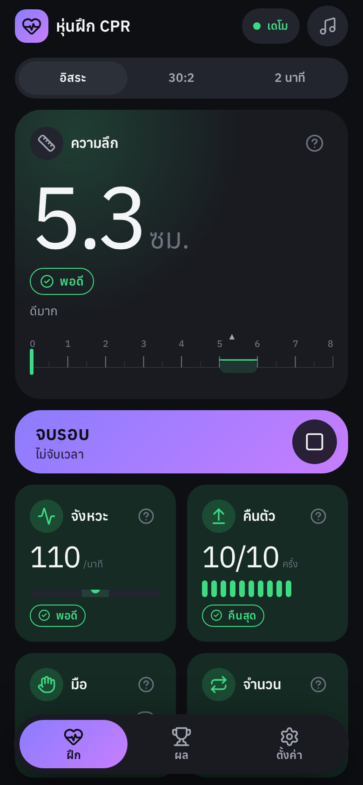
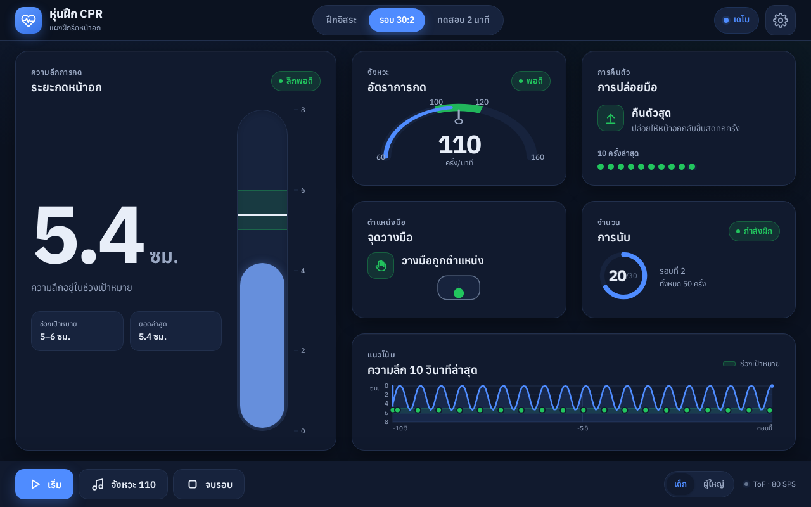
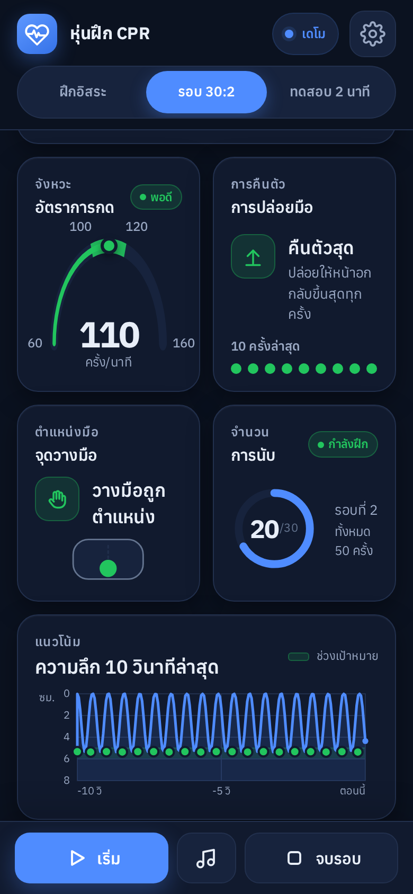
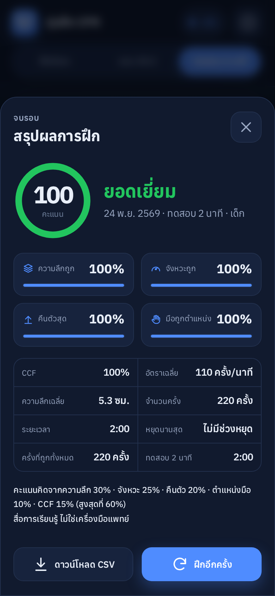
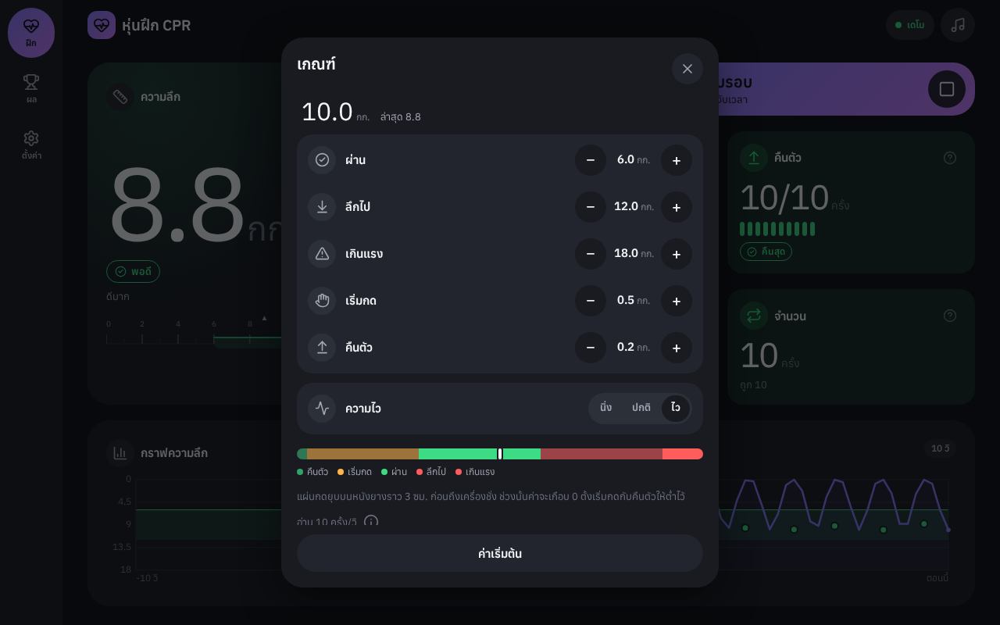
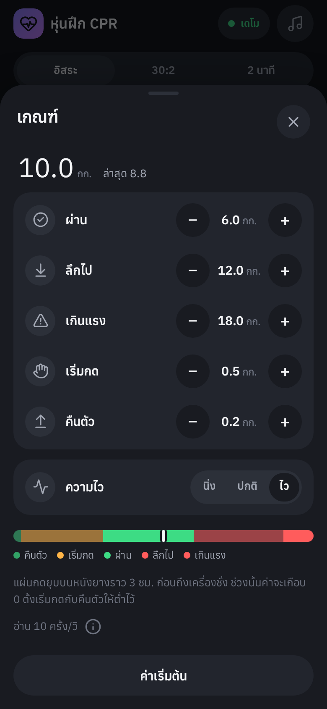

# หุ่นฝึก CPR เด็ก

หุ่นฝึกกดหน้าอกเด็ก เป็นโครงงานของโรงเรียน ใช้โหลดเซลล์ 20 กก. วัดแรงกด
มีหนังยางหน่วงให้แผ่นกดยุบลงราว 3 ซม. ก่อนถึงโหลดเซลล์
ผลโชว์ที่ LED 4 ดวง บัซเซอร์ และหน้าเว็บ เปิดดูผ่าน Wi-Fi ของ ESP32
หรือต่อสาย USB แล้วใช้ Web Serial

ESP32 รุ่นสุดท้ายตรวจ 3 อย่างในการกดแต่ละครั้ง

1. ความลึก
2. อัตราการกด
3. การคืนตัว

ส่วน build เก่าและ Nano ที่ยังมีสวิตช์มือ จะตรวจตำแหน่งมือเพิ่มอีกอย่าง

> สื่อการเรียนรู้ ไม่ใช่เครื่องมือแพทย์ ใช้ฝึกเท่านั้น

## อุปกรณ์

| ส่วน | จำนวน | หมายเหตุ |
|---|---|---|
| บอร์ด ESP32 (esp32dev) | 1 | ใช้ Wi-Fi และหน้าเว็บ |
| หรือ Arduino Nano ATmega328P | 1 | build เก่า ใช้ผ่าน USB อย่างเดียว |
| HX711 | 1 | ตัวขยายสัญญาณโหลดเซลล์ |
| โหลดเซลล์แท่ง 20 กก. | 1 | ยึดแบบคานใต้แผ่นกด |
| แผ่นกดแข็ง | 1 | อยู่ใต้ผิวหน้า รับแรงจากมือ |
| หนังยางเส้นหนา | 4–6 | ทำเป็นตัวหน่วงเหนือโหลดเซลล์ |
| ตัวหยุดแข็ง | 1 | จำกัดระยะกดที่ประมาณ 6–6.5 ซม. |
| LED 4 ดวง | 4 | กำลังกด ลึกพอดี ตื้นไป และลึกไป/แรงเกิน |
| ตัวต้านทาน 220–330 โอห์ม | 4 | ต่ออนุกรมกับ LED |
| บัซเซอร์แบบ active | 1 | ตั้งเสียงด้วยความถี่ของตัวมันเอง |
| ผิวหน้าและฐานแข็ง | ตามแบบ | ดู `docs/assembly.md` |
| อะคริลิก สกรู และเสาสเปเซอร์ | ตามแบบ | สำหรับยึดโหลดเซลล์และแผ่นกด |
| สายไฟ สายจั๊ม และผ้าคลุม | ตามต้องการ | จัดสายให้เป็นระเบียบ |

ขาที่ต้องต่อทั้งหมดอยู่ใน [`docs/wiring.md`](docs/wiring.md)

## เริ่มใช้ ESP32

1. เสียบ ESP32 แล้วอัปโหลดโค้ด

   ```
   pio run -e esp32dev -t upload
   ```

   ถ้าอัปโหลดไม่ผ่าน ให้กด BOOT ค้างไว้ กด EN หนึ่งครั้ง แล้วปล่อย BOOT
   จากนั้นอัปโหลดใหม่

2. เปิด Wi-Fi ในคอมหรือมือถือ แล้วเลือกชื่อ `CPR-Trainer-XXXX`
   รหัสผ่านเริ่มต้น `cprtrain123` (`XXXX` คือเลขท้ายของ MAC)

3. เปิดเบราว์เซอร์ไปที่ <http://192.168.4.1>
   หน้าเว็บจะเชื่อมต่อให้เองเมื่อเปิดจากที่อยู่นี้

ถ้าใช้สายที่ชาร์จได้อย่างเดียวแล้วตัวเลขค้างที่ 0 ให้ดูวิธีทดสอบสายชาร์จใน
[`docs/troubleshooting.md`](docs/troubleshooting.md#หน้าเว็บค้างที่-0-ถ้าไม่ได้เปิด-serial-monitor)
เฟิร์มแวร์ ESP32 รุ่นนี้จะไม่ส่งค่าสดออกทาง USB จนกว่าจะพิมพ์ `serial on` หน้าเว็บจึงไม่ค้างเพราะ USB อีก

โปรไฟล์เริ่มต้นคือ "เด็ก" เลือก "ผู้ใหญ่" ได้ที่แถวโปรไฟล์ในหน้าตั้งค่า
โหมดเริ่มต้นคือ "อิสระ"

## เริ่มใช้ Nano กับ Web Serial

Nano ไม่มี Wi-Fi จึงเปิดหน้าเว็บจากคอมพิวเตอร์ แล้วอ่านข้อมูลผ่านสาย USB

1. อัปโหลด

   ```
   pio run -e nano -t upload
   ```

   ถ้าเป็นบอร์ดโคลนที่ยังใช้ bootloader เก่า ให้ใช้

   ```
   pio run -e nano_oldbl -t upload
   ```

2. เปิดหน้าเว็บจากคอมของเรา

   ```
   python3 tools/devserver.py --port 8080
   ```

   แล้วเปิด <http://localhost:8080/> ใน Chrome หรือ Edge บนเดสก์ท็อป

3. ในหน้าเชื่อมต่อ เลือก "สาย USB" แล้วเลือกพอร์ตของ Nano
   ความเร็ว Serial ใช้ 115200 (สเก็ตช์เก่าใช้ 9600 ซึ่งช้าไปสำหรับข้อมูล 20 Hz)

Nano เป็น build เก่า ยังอ่านสวิตช์ฟอยล์ที่ขา D9
ส่วน build ปกติไม่มี VL53L0X จึงตั้งเกณฑ์ด้วยแรงแทน
โค้ดสองส่วนนี้ยังอยู่ แต่ปิดไว้ด้วย build flags ดู [`docs/OPEN_ISSUES.md`](docs/OPEN_ISSUES.md)

## เดโม

ไม่ต้องต่อหุ่นก็ดูหน้าเว็บได้ ในหน้าเชื่อมต่อให้กดการ์ด "เดโม"
แล้วเลือกข้อมูลตัวอย่าง `กดถูกต้อง`, `กดตื้นไป`, `รอบ 30:2`, `ทดสอบ 2 นาที`
หรือ `กดถูกต้อง (เครื่องชั่ง)` ที่แสดงเป็น กก. เหมือนหุ่นรุ่นสุดท้าย
ข้อมูลจะเล่นวนซ้ำเอง

ตอนแก้เว็บ มี URL พิเศษไว้ช่วยดูหน้าจอ

```
?demo=good              เลือกชุดข้อมูล
&speed=4                เร่งความเร็ว
&seek=30                กระโดดไปวินาทีที่ 30
&theme=light            ธีมสว่าง
&sheet=summary          เปิดหน้าสรุป
&sheet=calib            เปิดหน้าปรับเทียบ
&sheet=settings         เปิดหน้าตั้งค่า
&sheet=connect          เปิดหน้าเชื่อมต่อ
&sheet=info&info=score เปิดแผ่นข้อมูลหัวข้อคะแนน
&motion=freeze          ปิดแอนิเมชัน
```

ถ้าเปิดผ่าน `tools/devserver.py` ให้ใส่ `?ws=1` เพื่อรับข้อมูลจาก dev server

## เอกสาร

| เอกสาร | เนื้อหา |
|---|---|
| [`docs/wiring.md`](docs/wiring.md) | ตารางขาต่อ ESP32 รุ่นสุดท้ายและ Nano build เก่า พร้อมรูปประกอบ |
| [`docs/assembly.md`](docs/assembly.md) | วิธีประกอบหุ่น โหลดเซลล์ หนังยางหน่วง และตัวหยุดแข็ง |
| [`docs/calibration.md`](docs/calibration.md) | ตั้งศูนย์ ตั้งน้ำหนัก และปรับเกณฑ์ความลึก |
| [`docs/dashboard.md`](docs/dashboard.md) | วิธีเชื่อมต่อ การอ่านหน้าจอ เกณฑ์ คะแนน และ CSV |
| [`docs/troubleshooting.md`](docs/troubleshooting.md) | แก้ปัญหาที่พบบ่อย รวมถึงการทดสอบด้วยสายชาร์จ |
| [`docs/report.md`](docs/report.md) | เนื้อหาสำหรับเขียนรายงานโรงเรียน |
| [`docs/PROTOCOL.md`](docs/PROTOCOL.md) | รูปแบบข้อความ JSON และคำสั่ง (ภาษาอังกฤษ) |
| [`docs/DESIGN.md`](docs/DESIGN.md) | สเปกของโครงงาน |
| [`docs/OPEN_ISSUES.md`](docs/OPEN_ISSUES.md) | ข้อจำกัดและเรื่องที่ยังค้างอยู่ |

## โครงสร้างโปรเจกต์

| ที่อยู่ | เนื้อหา |
|---|---|
| `platformio.ini` | env `esp32dev`, `nano`, `nano_oldbl`, `native` |
| `lib/cpr_core/` | อัลกอริทึม C++ ใช้ร่วมกันทุกบอร์ด |
| `lib/cpr_sim/` | ตัวสร้างสัญญาณจำลองสำหรับ build บนคอมพิวเตอร์ |
| `src/esp32/` | เฟิร์มแวร์ ESP32, Wi-Fi, HTTP, WebSocket |
| `src/nano/` | เฟิร์มแวร์ Nano, Serial อย่างเดียว |
| `web/` | หน้าแดชบอร์ด `index.html`, `app.css`, `app.js`, ฟอนต์ และเดโม |
| `tools/` | สคริปต์ build ซิมูเลเตอร์ dev server และภาพหน้าจอ |
| `recordings/` | ไฟล์ JSONL จากซิมูเลเตอร์ |
| `test/test_core/` | ยูนิตเทสต์ Unity |
| `docs/` | เอกสารและภาพหน้าจอ |
| `vendor/fonts/` | ฟอนต์ต้นฉบับ Anuphan และสัญญาอนุญาต |

## สร้างและทดสอบ

```
pio test -e native
bash tools/verify.sh
```

`tools/verify.sh` รันเทสต์บนเครื่อง แล้ว build ทั้ง `esp32dev` และ `nano`
ถ้าต้องการ build อย่างเดียว

```
pio run -e esp32dev
pio run -e nano
```

ซิมูเลเตอร์

```
bash tools/sim/build.sh
.simbin/cpr_sim --scenario good --seconds 40 --sps 80 --out recordings/good.jsonl
bash tools/sim/make_recordings.sh
```

เซิร์ฟเวอร์สำหรับดูหน้าเว็บพร้อมข้อมูลตัวอย่าง

```
python3 tools/devserver.py --port 8080 --recording recordings/good.jsonl --loop
```

## ภาพหน้าจอ

ภาพต่อไปนี้มาจากเดโม ขนาด 1280×800, 390×844 และแนวนอน 844×390

| หน้าจอ | 1280×800 | 390×844 | 844×390 |
|---|---|---|---|
| หน้าฝึก (อิสระ) |  |  | |
| รอบ 30:2 |  |  | |
| รอให้ลม 2 ครั้ง |  |  | |
| สรุปผล |  |  | |
| ปรับเทียบ |  |  | |
| กดตื้นไป |  |  | |
| ธีมสว่าง |  | | |
| เชื่อมต่อ |  |  | |
| ตั้งค่า |  |  | |
| เกณฑ์ |  |  | |
| แผ่นข้อมูลคะแนน | |  | |
| หน้าฝึกแนวนอน | | |  |
