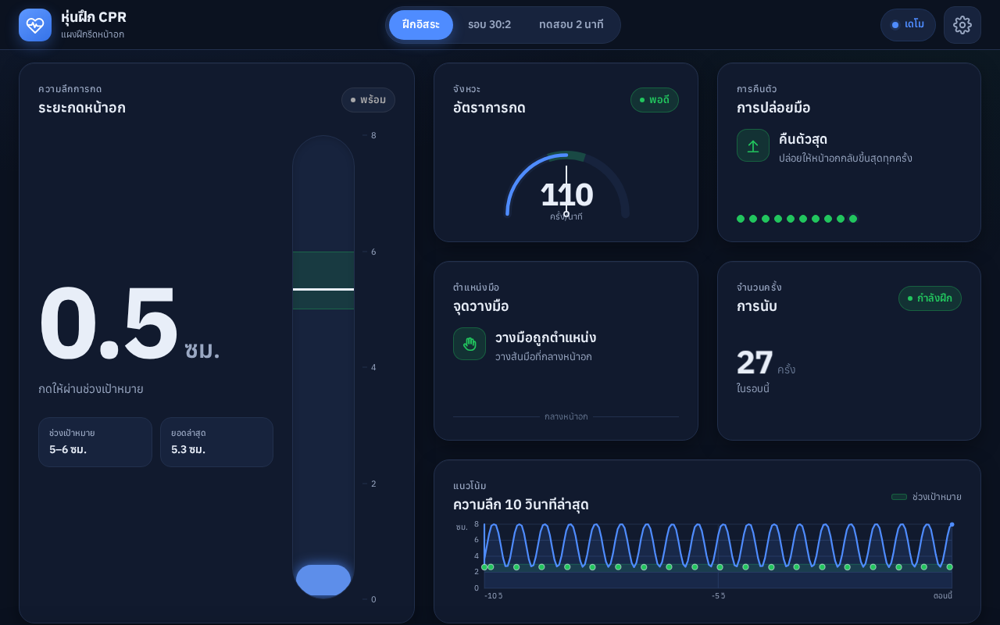
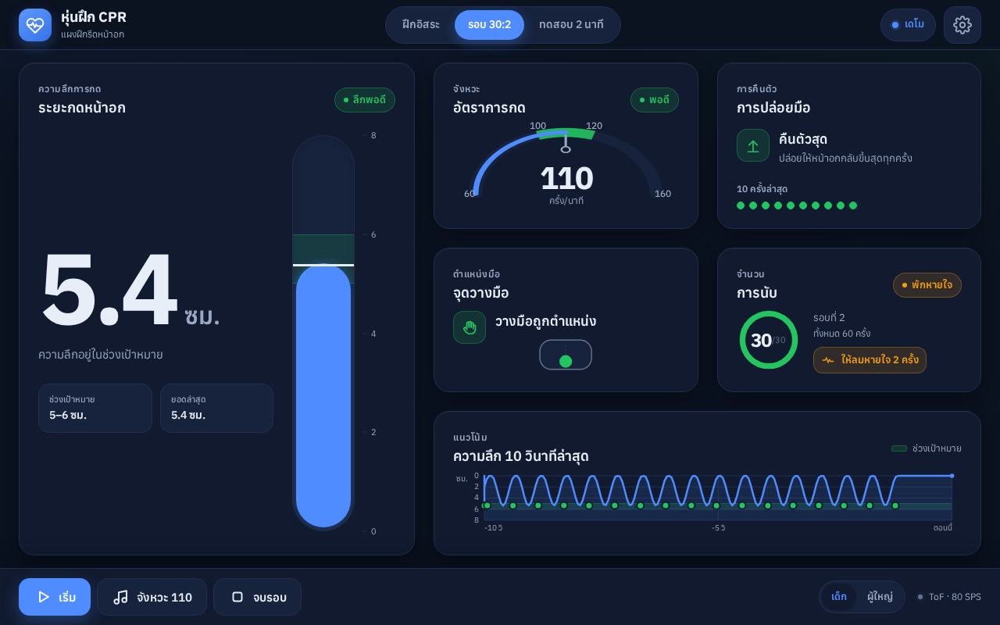
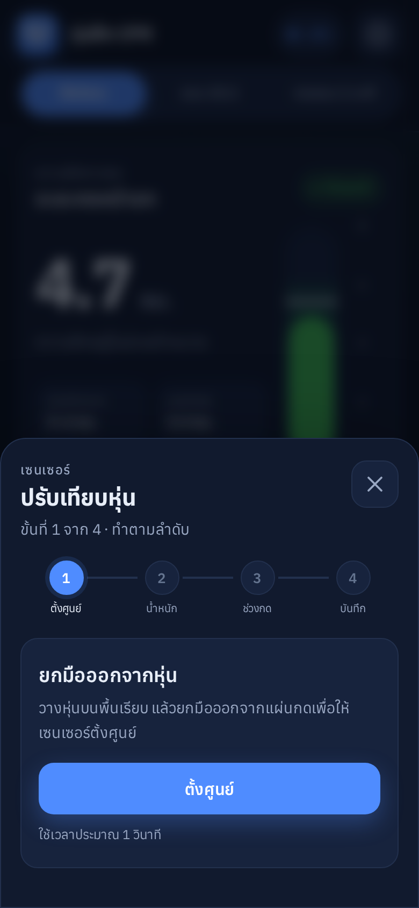
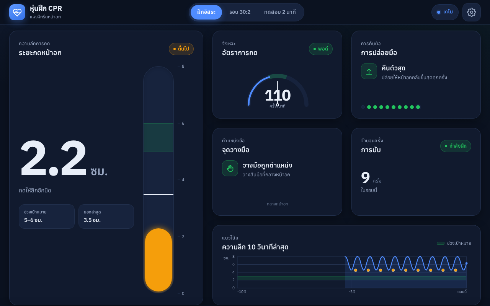

# หุ่นฝึก CPR เด็ก

หุ่นฝึกกดหน้าอกสำหรับเด็ก ทำเป็นโครงงานโรงเรียน ใช้โหลดเซลล์วัดแรงกด
ใช้เซนเซอร์ VL53L0X วัดระยะกด (ถ้าติดตั้ง) และใช้สวิตช์ฟอยล์ตรวจตำแหน่งมือ
เฟิร์มแวร์ตรวจ 4 อย่างต่อการกดหนึ่งครั้ง

1. ความลึก
2. อัตราการกด
3. การคืนตัว
4. ตำแหน่งมือ

ผลแสดงด้วย LED 4 ดวง บัซเซอร์ และหน้าเว็บ แดชบอร์ดอ่านผ่าน Wi-Fi ของ ESP32
หรือผ่านสาย USB ด้วย Web Serial

> สื่อการเรียนรู้ ไม่ใช่เครื่องมือแพทย์ ใช้ฝึกทักษะเท่านั้น

## อุปกรณ์

| ส่วน | จำนวน | หมายเหตุ |
|---|---|---|
| บอร์ด ESP32 (esp32dev) | 1 | ใช้ Wi-Fi และหน้าเว็บ |
| หรือ Arduino Nano ATmega328P | 1 | ใช้ผ่าน USB อย่างเดียว |
| HX711 | 1 | ตัวขยายสัญญาณโหลดเซลล์ |
| โหลดเซลล์แท่ง 20 กก. | 1 | ยึดแบบคานใต้แผ่นกด |
| VL53L0X | 1 | ไม่บังคับ ใช้กับ ESP32 |
| LED สีเขียว เหลือง แดง และ LED ตำแหน่งมือ | 4 | ใช้แทนกันได้ตามสีที่มี |
| ตัวต้านทาน 220–330 โอห์ม | 4 | ต่ออนุกรมกับ LED |
| บัซเซอร์แบบ active | 1 | ตั้งเสียงด้วยความถี่ของตัวมันเอง |
| ฟองน้ำ ผิวหน้า ฐานแข็ง | ตามแบบ | ดู `docs/assembly.md` |
| อะคริลิก สกรู และเสาสเปเซอร์ | ตามแบบ | สำหรับยึดโหลดเซลล์ |
| ฟอยล์อะลูมิเนียม 2 แผ่น | 1 ชุด | ทำสวิตช์ตำแหน่งมือ |
| สายไฟ สายจั๊ม และผ้าคลุม | ตามต้องการ | เก็บสายให้เรียบร้อย |

รายละเอียดขาต่อทุกขาอยู่ที่ [`docs/wiring.md`](docs/wiring.md)

## เริ่มใช้ ESP32

1. เสียบ ESP32 แล้วอัปโหลด

   ```
   pio run -e esp32dev -t upload
   ```

   ถ้าอัปโหลดไม่ขึ้น ให้กดปุ่ม BOOT ค้างไว้ กด EN หนึ่งครั้ง แล้วปล่อย BOOT
   จากนั้นสั่งอัปโหลดใหม่

2. เปิด Wi-Fi ของคอมพิวเตอร์หรือมือถือ เลือกชื่อ `CPR-Trainer-XXXX`
   รหัสผ่านเริ่มต้น `cprtrain123` (`XXXX` คือเลขท้ายของ MAC)

3. เปิดเบราว์เซอร์ไปที่ <http://192.168.4.1>
   หน้าเว็บจะเชื่อมต่อให้เองเมื่อเปิดจากที่อยู่นี้

ค่าเริ่มต้นของโปรไฟล์คือ **เด็ก** เลือก **ผู้ใหญ่** ได้ที่แถบล่างหรือในหน้าตั้งค่า
โหมดเริ่มต้นคือ **ฝึกอิสระ**

## เริ่มใช้ Nano กับ Web Serial

Nano ไม่มี Wi-Fi จึงใช้หน้าเว็บที่เสิร์ฟจากคอมพิวเตอร์ แล้วอ่านข้อมูลผ่านสาย USB

1. อัปโหลด

   ```
   pio run -e nano -t upload
   ```

   บอร์ดโคลนที่ยังใช้ bootloader เก่าให้ใช้

   ```
   pio run -e nano_oldbl -t upload
   ```

2. เปิดหน้าเว็บจากเครื่องตัวเอง

   ```
   python3 tools/devserver.py --port 8080
   ```

   แล้วเปิด <http://localhost:8080/> ใน Chrome หรือ Edge บนเดสก์ท็อป

3. ในหน้าเชื่อมต่อ เลือก **สาย USB (Web Serial)** แล้วเลือกพอร์ตของ Nano
   ความเร็ว Serial คือ **115200** (สเก็ตช์เก่าใช้ 9600 ซึ่งช้าเกินไปสำหรับข้อมูล 20 Hz)

Nano ที่ build ตามปกติยังไม่มีความจำพอสำหรับ VL53L0X จึงใช้โหมดวัดด้วยแรง
และตั้งช่วง กก. แทน (ดู [`docs/OPEN_ISSUES.md`](docs/OPEN_ISSUES.md))

## โหมดเดโม

ไม่ต้องต่อหุ่นก็ดูหน้าเว็บได้ ในหน้าเชื่อมต่อเลือก **โหมดเดโม**
แล้วเลือกข้อมูลตัวอย่าง `กดถูกต้อง`, `กดตื้นไป`, `รอบ 30:2` หรือ `ทดสอบ 2 นาที`
ข้อมูลจะเล่นซ้ำอัตโนมัติ

ตอนพัฒนาเว็บมี URL ช่วยดูหน้าจอ

```
?demo=good          เลือกชุดข้อมูล
&speed=4            เร่งความเร็ว
&seek=30            กระโดดไปวินาทีที่ 30
&theme=light        ธีมสว่าง
&sheet=summary      เปิดหน้าสรุป
&sheet=calib        เปิดหน้าปรับเทียบ
&sheet=connect      เปิดหน้าเชื่อมต่อ
```

ถ้าเปิดผ่าน `tools/devserver.py` ใช้ `?ws=1` เพื่อรับข้อมูลจาก dev server

## เอกสาร

| เอกสาร | เนื้อหา |
|---|---|
| [`docs/wiring.md`](docs/wiring.md) | ตารางขาต่อ ESP32 และ Nano พร้อมรูปประกอบ |
| [`docs/assembly.md`](docs/assembly.md) | วิธีประกอบหุ่น ชั้นฟองน้ำ โหลดเซลล์ และสวิตช์ฟอยล์ |
| [`docs/calibration.md`](docs/calibration.md) | ตั้งศูนย์ ตั้งน้ำหนัก และตั้งช่วงความลึก |
| [`docs/dashboard.md`](docs/dashboard.md) | วิธีเชื่อมต่อ การอ่านหน้าจอ คะแนน และ CSV |
| [`docs/troubleshooting.md`](docs/troubleshooting.md) | แก้ปัญหาที่พบบ่อย |
| [`docs/report.md`](docs/report.md) | เนื้อหาสำหรับเขียนรายงานโรงเรียน |
| [`docs/PROTOCOL.md`](docs/PROTOCOL.md) | รูปแบบข้อความ JSON และคำสั่ง (ภาษาอังกฤษ) |
| [`docs/DESIGN.md`](docs/DESIGN.md) | สเปกของโครงงาน |
| [`docs/OPEN_ISSUES.md`](docs/OPEN_ISSUES.md) | ข้อจำกัดและเรื่องที่ยังค้างอยู่ |

## โครงสร้างโปรเจกต์

| ที่อยู่ | เนื้อหา |
|---|---|
| `platformio.ini` | env `esp32dev`, `nano`, `nano_oldbl`, `native` |
| `lib/cpr_core/` | อัลกอริทึม C++ ใช้ร่วมกันทุกบอร์ด |
| `lib/cpr_sim/` | ตัวสร้างสัญญาณจำลองสำหรับ build บนคอมพิวเตอร์ |
| `src/esp32/` | เฟิร์มแวร์ ESP32, Wi-Fi, HTTP, WebSocket |
| `src/nano/` | เฟิร์มแวร์ Nano, Serial อย่างเดียว |
| `web/` | หน้าแดชบอร์ด `index.html`, `app.css`, `app.js`, ฟอนต์ และเดโม |
| `tools/` | สคริปต์ build ซิมูเลเตอร์ dev server และภาพหน้าจอ |
| `recordings/` | ไฟล์ JSONL จากซิมูเลเตอร์ |
| `test/test_core/` | ยูนิตเทสต์ Unity |
| `docs/` | เอกสารและภาพหน้าจอ |
| `vendor/fonts/` | ฟอนต์ต้นฉบับ Anuphan และสัญญาอนุญาต |

## สร้างและทดสอบ

```
pio test -e native
bash tools/verify.sh
```

`tools/verify.sh` รันเทสต์บนเครื่อง แล้ว build ทั้ง `esp32dev` และ `nano`
ถ้าต้องการ build อย่างเดียว

```
pio run -e esp32dev
pio run -e nano
```

ซิมูเลเตอร์

```
bash tools/sim/build.sh
.simbin/cpr_sim --scenario good --seconds 40 --sps 80 --out recordings/good.jsonl
bash tools/sim/make_recordings.sh
```

เซิร์ฟเวอร์สำหรับดูหน้าเว็บพร้อมข้อมูลตัวอย่าง

```
python3 tools/devserver.py --port 8080 --recording recordings/good.jsonl --loop
```

## ภาพหน้าจอ

ภาพต่อไปนี้มาจากโหมดเดโม ภาพเดสก์ท็อปขนาด 1280×800 และภาพมือถือขนาด 390×844

| หน้าจอ | เดสก์ท็อป | มือถือ |
|---|---|---|
| ฝึกอิสระ |  |  |
| รอบ 30:2 |  |  |
| ครบ 30 ครั้ง รอหายใจ |  |  |
| สรุปผล |  |  |
| ปรับเทียบ |  |  |
| กดตื้นไป |  |  |
| ธีมสว่าง |  | |
| เชื่อมต่อ |  |  |
