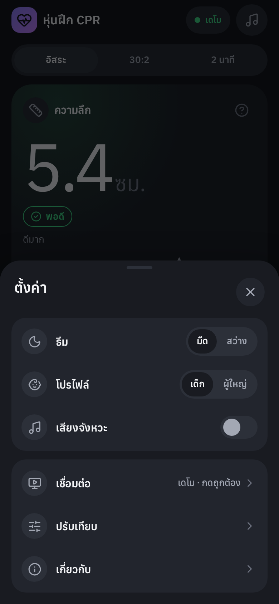
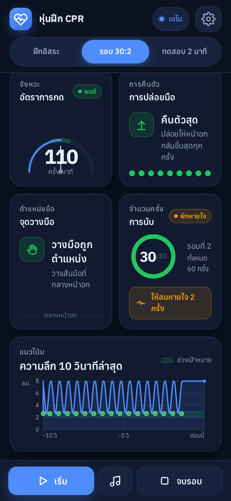
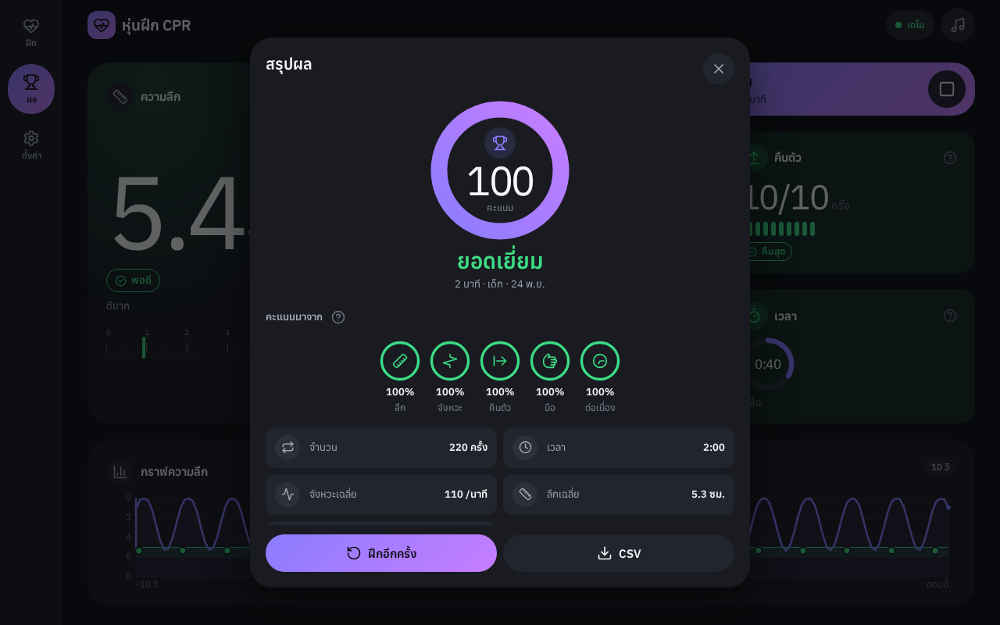
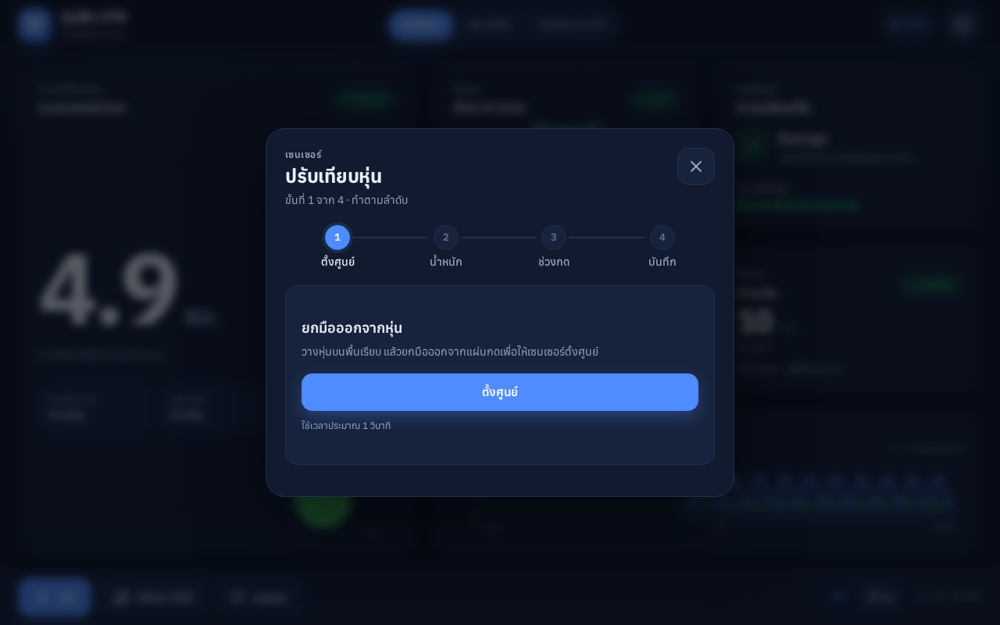
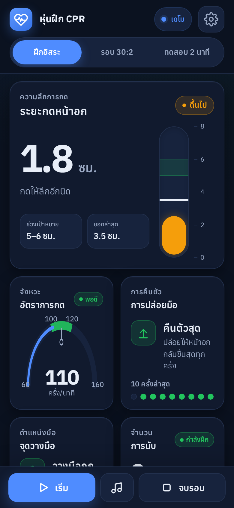
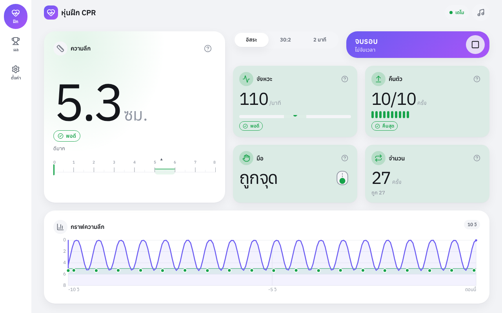
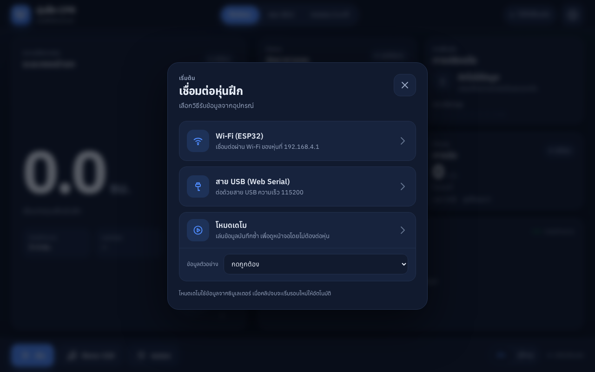
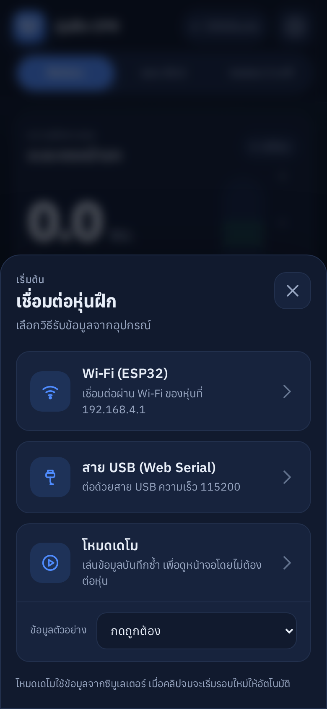

<h1 align="center">CPR Smart Chest</h1>
<p align="center">หุ่นจำลองฝึกการช่วยฟื้นคืนชีพ (CPR) ในเด็ก พร้อมระบบแสดงผลย้อนกลับแบบทันที</p>

<p align="center">
  <a href="docs/dashboard.md">คู่มือแดชบอร์ด</a> ·
  <a href="docs/assembly.md">คู่มือการประกอบ</a> ·
  <a href="docs/troubleshooting.md">การแก้ไขปัญหา</a>
</p>

---

CPR Smart Chest เป็นผลงานที่ผู้จัดทำจัดทำขึ้นเพื่อส่งอาจารย์ตามงานที่ได้รับมอบหมาย หัวข้อ "การสร้างหุ่นจำลองฝึก CPR ในเด็กจากวัสดุทดแทน" ผลงานคือหุ่นจำลองลำตัวเด็กสำหรับใช้เป็นสื่อการเรียนรู้เรื่องการช่วยฟื้นคืนชีพขั้นพื้นฐาน พร้อมระบบแสดงผลย้อนกลับขณะกด

หุ่นมีโครงสร้างสามชั้น ได้แก่ ผิวหน้าจำลอง ชั้นหน่วงแรงต้าน และฐานแข็ง เมื่อกดลงจะเกิดแรงต้าน และเมื่อปล่อยหน้าอกจะคืนตัว ระบบ Feedback ใช้โหลดเซลล์วัดแรงกด แล้วแสดงผลด้วยไฟ LED เสียงบัซเซอร์ และหน้าเว็บแดชบอร์ด

> สื่อการเรียนรู้ ไม่ใช่เครื่องมือแพทย์ ใช้ฝึกเท่านั้น

<table>
<tr>
<td></td>
<td></td>
<td></td>
<td></td>
</tr>
</table>

## วัตถุประสงค์

1. เพื่อสร้างหุ่นจำลองลำตัวเด็กสำหรับใช้อธิบายตำแหน่งและวิธีกดหน้าอกในการเรียนรู้เรื่อง CPR
2. เพื่อประยุกต์ใช้วัสดุที่หาได้ง่ายและประหยัดในการสร้างสื่อการเรียนรู้
3. เพื่อเพิ่มระบบแสดงผลย้อนกลับ ได้แก่ ไฟ เสียง และการวัดความลึก ให้ผู้ฝึกรู้ว่ากดได้ถูกต้องหรือไม่
4. เพื่อให้ผลงานปลอดภัยต่อผู้ใช้งาน และชัดเจนว่าเป็นสื่อการเรียนรู้ ไม่ใช่เครื่องมือแพทย์

## ระบบทำอะไรได้

- **ตรวจการกดแต่ละครั้ง** ใน 3 ด้าน คือ ความลึก อัตราการกด (เป้าหมาย 100–120 ครั้งต่อนาที) และการคืนตัวของหน้าอก รุ่นที่ยังมีสวิตช์มือจะตรวจตำแหน่งมือเพิ่มอีกด้านหนึ่ง
- **แสดงผลด้วย LED 4 ดวง** ได้แก่ กำลังกด ลึกพอดี ตื้นไป และลึกไปหรือแรงเกิน
- **บัซเซอร์และเสียงจังหวะ** ช่วยให้กดตามจังหวะ 110 ครั้งต่อนาที
- **แดชบอร์ดบนเว็บ** แสดงความลึก อัตราการกด การคืนตัว และกราฟย้อนหลัง 10 วินาที ใช้งานได้ทั้งบนมือถือและคอมพิวเตอร์
- **โหมดฝึก 3 โหมด** คือ อิสระ รอบ 30:2 และทดสอบ 2 นาที
- **สรุปผลและคะแนน** เต็ม 100 พร้อมส่งออกข้อมูลเป็นไฟล์ CSV
- **ปรับเทียบและตั้งเกณฑ์น้ำหนัก** ได้จากหน้าเว็บ โดยไม่ต้องแก้โค้ด
- **โหมดเดโม** ดูหน้าเว็บได้โดยไม่ต้องต่อหุ่น

## เกณฑ์การประเมิน

เกณฑ์อ้างอิงแนวทางของ AHA ปี 2025 รายละเอียดและที่มาของตัวเลขอยู่ใน [`docs/DESIGN.md`](docs/DESIGN.md)

| รายการ | เกณฑ์ |
|---|---|
| ความลึก (เด็ก) | ประมาณ 5 ซม. ไม่เกิน 6 ซม. |
| ความลึก (ผู้ใหญ่) | 5–6 ซม. |
| อัตราการกด | 100–120 ครั้งต่อนาที |
| การคืนตัว | ปล่อยให้หน้าอกคืนตัวสุดทุกครั้ง |
| การหยุดกด | ครั้งละไม่เกิน 10 วินาที และเวลากดต่อเนื่อง (CCF) ไม่น้อยกว่า 60% |
| อัตราส่วนกดต่อช่วยหายใจ | 30:2 |

คะแนนรวม 100 คะแนน แบ่งเป็น ความลึก 30% อัตราการกด 25% การคืนตัว 20% ตำแหน่งมือ 10% และการกดต่อเนื่อง 15% สัดส่วนนี้ทีมผู้จัดทำกำหนดเอง ไม่ใช่เกณฑ์ทางการ

## โครงสร้างของหุ่น

แรงจากมือส่งผ่านผิวหน้า ลงแผ่นกดแข็ง และผ่านหนังยางหน่วงไปยังโหลดเซลล์ หนังยางทำให้แผ่นกดยุบได้ราว 3 ซม. ก่อนถึงโหลดเซลล์ และมีตัวหยุดแข็งจำกัดระยะกดไว้ที่ประมาณ 6–6.5 ซม.

| ชั้น | หน้าที่ |
|---|---|
| ผิวหน้า | ผ้าหรือผ้ายืดหุ้มด้านนอก ให้พื้นผิวเรียบและปกปิดโครงสร้างด้านใน |
| แผ่นกดและชั้นหน่วง | แผ่นกดแข็งวางบนหนังยาง ทำหน้าที่สร้างแรงต้านและให้คืนตัวหลังปล่อย |
| ฐานแข็ง | ยึดโหลดเซลล์และตัวหยุด ให้โครงสร้างมั่นคง |

วัสดุที่เลือกใช้ควรสะอาด ไม่มีกลิ่นฉุน และไม่มีขอบแหลมคม ดูขั้นตอนการประกอบทั้งหมดได้ที่ [`docs/assembly.md`](docs/assembly.md)

## อุปกรณ์

| ส่วน | จำนวน | หมายเหตุ |
|---|---|---|
| บอร์ด ESP32 (esp32dev) | 1 | ใช้ Wi-Fi และหน้าเว็บ |
| หรือ Arduino Nano ATmega328P | 1 | build เก่า ใช้ผ่าน USB อย่างเดียว |
| HX711 | 1 | ตัวขยายสัญญาณโหลดเซลล์ |
| โหลดเซลล์แท่ง 20 กก. | 1 | ยึดแบบคานใต้แผ่นกด |
| แผ่นกดแข็ง | 1 | อยู่ใต้ผิวหน้า รับแรงจากมือ |
| หนังยางเส้นหนา | 4–6 | ใช้เป็นตัวหน่วงเหนือโหลดเซลล์ |
| ตัวหยุดแข็ง | 1 | จำกัดระยะกดที่ประมาณ 6–6.5 ซม. |
| LED | 4 | กำลังกด ลึกพอดี ตื้นไป และลึกไปหรือแรงเกิน |
| ตัวต้านทาน 220–330 โอห์ม | 4 | ต่ออนุกรมกับ LED |
| บัซเซอร์แบบ active | 1 | ส่งเสียงด้วยความถี่ของตัวมันเอง |
| ผิวหน้า และฐานแข็ง | ตามแบบ | ดู [`docs/assembly.md`](docs/assembly.md) |
| อะคริลิก สกรู และเสาสเปเซอร์ | ตามแบบ | สำหรับยึดโหลดเซลล์และแผ่นกด |
| สายไฟ สายจั๊ม และผ้าคลุม | ตามต้องการ | จัดสายให้เป็นระเบียบ |

ตำแหน่งขาที่ต้องต่อทั้งหมดอยู่ใน [`docs/wiring.md`](docs/wiring.md)

## เทคโนโลยีที่ใช้

| ส่วน | ใช้อะไร |
|---|---|
| ไมโครคอนโทรลเลอร์ | ESP32 (หลัก) และ Arduino Nano (build เก่า) |
| เซนเซอร์ | โหลดเซลล์ 20 กก. ผ่าน HX711 |
| เฟิร์มแวร์ | C++ บน [PlatformIO](https://platformio.org/) ส่วนอัลกอริทึมอยู่ใน `lib/cpr_core` ใช้ร่วมกันทุกบอร์ด |
| การสื่อสาร | Wi-Fi (HTTP และ WebSocket) หรือ USB (Web Serial) |
| แดชบอร์ด | HTML, CSS และ JavaScript ล้วน ไม่ใช้ไลบรารีภายนอกและไม่ต้องใช้อินเทอร์เน็ต |
| ฟอนต์ | Anuphan (สัญญาอนุญาต OFL) |
| การทดสอบ | Unity บน PlatformIO (`pio test -e native`) |

## โครงสร้างโปรเจกต์

| ที่อยู่ | เนื้อหา |
|---|---|
| `platformio.ini` | env `esp32dev`, `nano`, `nano_oldbl`, `native` |
| `lib/cpr_core/` | อัลกอริทึม C++ ใช้ร่วมกันทุกบอร์ด |
| `lib/cpr_sim/` | ตัวสร้างสัญญาณจำลองสำหรับ build บนคอมพิวเตอร์ |
| `src/esp32/` | เฟิร์มแวร์ ESP32, Wi-Fi, HTTP, WebSocket |
| `src/nano/` | เฟิร์มแวร์ Nano, Serial อย่างเดียว |
| `web/` | หน้าแดชบอร์ด `index.html`, `app.css`, `app.js`, ฟอนต์ และเดโม |
| `tools/` | สคริปต์ build ซิมูเลเตอร์ dev server และภาพหน้าจอ |
| `recordings/` | ไฟล์ JSONL จากซิมูเลเตอร์ |
| `test/test_core/` | ยูนิตเทสต์ Unity |
| `docs/` | เอกสารและภาพหน้าจอ |
| `vendor/fonts/` | ฟอนต์ต้นฉบับ Anuphan และสัญญาอนุญาต |

## เริ่มใช้งาน ESP32

1. เสียบ ESP32 แล้วอัปโหลดเฟิร์มแวร์

   ```bash
   pio run -e esp32dev -t upload
   ```

   หากอัปโหลดไม่ผ่าน ให้กดปุ่ม BOOT ค้างไว้ กดปุ่ม EN หนึ่งครั้ง แล้วปล่อย BOOT จากนั้นอัปโหลดอีกครั้ง

2. เปิด Wi-Fi บนคอมพิวเตอร์หรือโทรศัพท์ แล้วเลือกเครือข่าย `CPR-Trainer-XXXX` (`XXXX` คือเลขท้ายของ MAC) รหัสผ่านเริ่มต้นคือ `cprtrain123`

3. เปิดเบราว์เซอร์ไปที่ <http://192.168.4.1> หน้าเว็บจะเชื่อมต่อกับหุ่นโดยอัตโนมัติ

โปรไฟล์เริ่มต้นคือ "เด็ก" เลือก "ผู้ใหญ่" ได้ที่แถวโปรไฟล์ในหน้าตั้งค่า และโหมดเริ่มต้นคือ "อิสระ"

หากตัวเลขค้างที่ 0 เมื่อใช้สายที่ชาร์จได้อย่างเดียว ให้ดูวิธีทดสอบใน [`docs/troubleshooting.md`](docs/troubleshooting.md#หน้าเว็บค้างที่-0-ถ้าไม่ได้เปิด-serial-monitor) เฟิร์มแวร์ ESP32 จะไม่ส่งค่าสดออกทาง USB จนกว่าจะพิมพ์ `serial on`

## เริ่มใช้งาน Nano ผ่าน Web Serial

Nano ไม่มี Wi-Fi จึงต้องเปิดหน้าเว็บจากคอมพิวเตอร์ แล้วอ่านข้อมูลผ่านสาย USB

1. อัปโหลดเฟิร์มแวร์

   ```bash
   pio run -e nano -t upload
   ```

   หากเป็นบอร์ดโคลนที่ยังใช้ bootloader เก่า ให้ใช้

   ```bash
   pio run -e nano_oldbl -t upload
   ```

2. เปิดหน้าเว็บจากคอมพิวเตอร์

   ```bash
   python3 tools/devserver.py --port 8080
   ```

   จากนั้นเปิด <http://localhost:8080/> ใน Chrome หรือ Edge บนคอมพิวเตอร์

3. ในหน้าเชื่อมต่อ เลือก "สาย USB" แล้วเลือกพอร์ตของ Nano ความเร็ว Serial ใช้ 115200

Nano เป็น build เก่าที่ยังอ่านสวิตช์ฟอยล์ที่ขา D9 ส่วน build ปกติไม่มี VL53L0X จึงตั้งเกณฑ์ด้วยแรงแทน โค้ดทั้งสองส่วนยังอยู่ แต่ปิดไว้ด้วย build flags ดู [`docs/OPEN_ISSUES.md`](docs/OPEN_ISSUES.md)

## โหมดเดโม

สามารถดูหน้าเว็บได้โดยไม่ต้องต่อหุ่น ให้เลือกการ์ด "เดโม" ในหน้าเชื่อมต่อ แล้วเลือกข้อมูลตัวอย่างอย่างใดอย่างหนึ่ง ได้แก่ `กดถูกต้อง`, `กดตื้นไป`, `รอบ 30:2`, `ทดสอบ 2 นาที` หรือ `กดถูกต้อง (เครื่องชั่ง)` ข้อมูลจะเล่นวนซ้ำโดยอัตโนมัติ

สำหรับนักพัฒนา สามารถกำหนดพารามิเตอร์ใน URL เพื่อเปิดหน้าจอที่ต้องการได้

```text
?demo=good              เลือกชุดข้อมูล
&speed=4                เร่งความเร็ว
&seek=30                ข้ามไปวินาทีที่ 30
&theme=light            ธีมสว่าง
&sheet=summary          เปิดหน้าสรุปผล
&sheet=calib            เปิดหน้าปรับเทียบ
&sheet=settings         เปิดหน้าตั้งค่า
&sheet=connect          เปิดหน้าเชื่อมต่อ
&sheet=info&info=score  เปิดแผ่นข้อมูลหัวข้อคะแนน
&motion=freeze          ปิดแอนิเมชัน
```

หากเปิดผ่าน `tools/devserver.py` ให้เพิ่ม `?ws=1` เพื่อรับข้อมูลจาก dev server

## การสร้างและทดสอบ

```bash
pio test -e native
bash tools/verify.sh
```

`tools/verify.sh` ทดสอบบนเครื่อง แล้วสร้างเฟิร์มแวร์ของ `esp32dev` และ `nano` หากต้องการสร้างเฟิร์มแวร์อย่างเดียว

```bash
pio run -e esp32dev
pio run -e nano
```

ซิมูเลเตอร์และเซิร์ฟเวอร์สำหรับดูหน้าเว็บพร้อมข้อมูลตัวอย่าง

```bash
bash tools/sim/build.sh
.simbin/cpr_sim --scenario good --seconds 40 --sps 80 --out recordings/good.jsonl
bash tools/sim/make_recordings.sh
python3 tools/devserver.py --port 8080 --recording recordings/good.jsonl --loop
```

## เอกสาร

| เอกสาร | เนื้อหา |
|---|---|
| [`docs/wiring.md`](docs/wiring.md) | ตารางขาต่อของ ESP32 รุ่นสุดท้ายและ Nano build เก่า พร้อมรูปประกอบ |
| [`docs/assembly.md`](docs/assembly.md) | วิธีประกอบหุ่น โหลดเซลล์ หนังยางหน่วง และตัวหยุดแข็ง |
| [`docs/calibration.md`](docs/calibration.md) | การตั้งศูนย์ ตั้งน้ำหนัก และปรับเกณฑ์ความลึก |
| [`docs/dashboard.md`](docs/dashboard.md) | การเชื่อมต่อ การอ่านหน้าจอ เกณฑ์ คะแนน และไฟล์ CSV |
| [`docs/troubleshooting.md`](docs/troubleshooting.md) | การแก้ไขปัญหาที่พบบ่อย รวมถึงการทดสอบด้วยสายชาร์จ |
| [`docs/report.md`](docs/report.md) | เนื้อหาสำหรับใช้เขียนรายงานของโรงเรียน |
| [`docs/PROTOCOL.md`](docs/PROTOCOL.md) | รูปแบบข้อความ JSON และคำสั่ง (ภาษาอังกฤษ) |
| [`docs/DESIGN.md`](docs/DESIGN.md) | สเปกของโครงงาน |
| [`docs/OPEN_ISSUES.md`](docs/OPEN_ISSUES.md) | ข้อจำกัดและเรื่องที่ยังค้างอยู่ |

## ภาพหน้าจอ

ภาพทั้งหมดมาจากโหมดเดโม ขนาด 1280×800, 390×844 และแนวนอน 844×390

| หน้าจอ | 1280×800 | 390×844 | 844×390 |
|---|---|---|---|
| หน้าฝึก (อิสระ) |  |  | |
| รอบ 30:2 |  |  | |
| รอให้ลม 2 ครั้ง |  |  | |
| สรุปผล |  |  | |
| ปรับเทียบ |  |  | |
| กดตื้นไป |  |  | |
| ธีมสว่าง |  | | |
| เชื่อมต่อ |  |  | |
| ตั้งค่า |  |  | |
| เกณฑ์ |  |  | |
| แผ่นข้อมูลคะแนน | |  | |
| หน้าฝึกแนวนอน | | |  |

## ผู้จัดทำ

**จัดทำโดย:** [Athivarat R.](https://www.instagram.com/athivaratz)

**เสนอ:** อาจารย์นารีรัตถ์ แถมยิ้ม (ผู้มอบหมายงาน)
