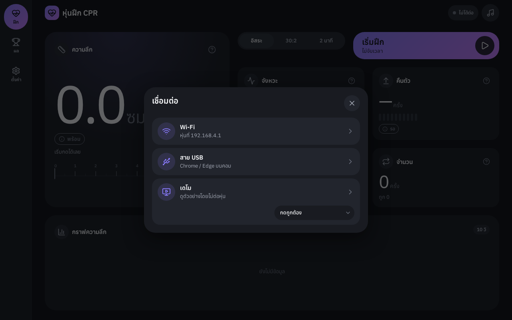
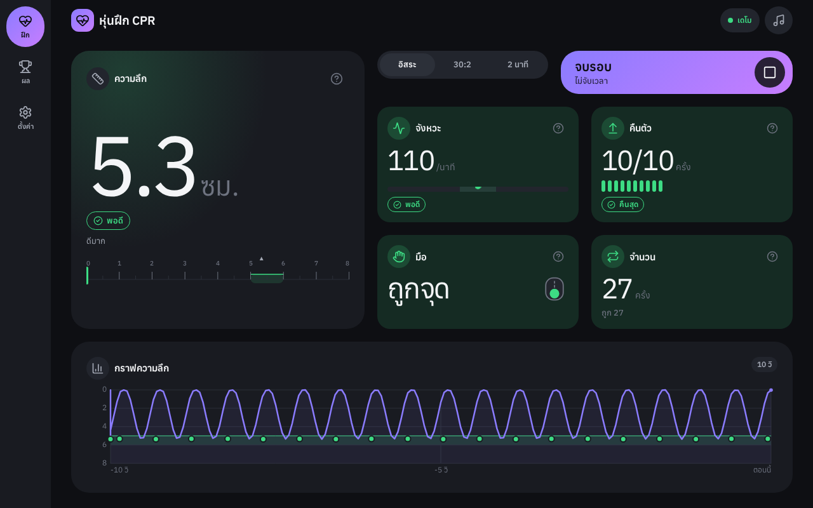
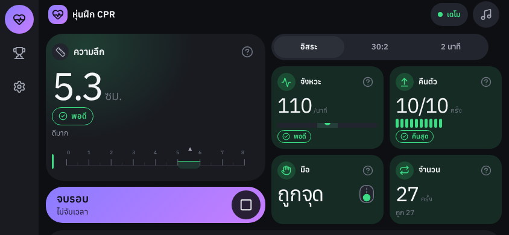
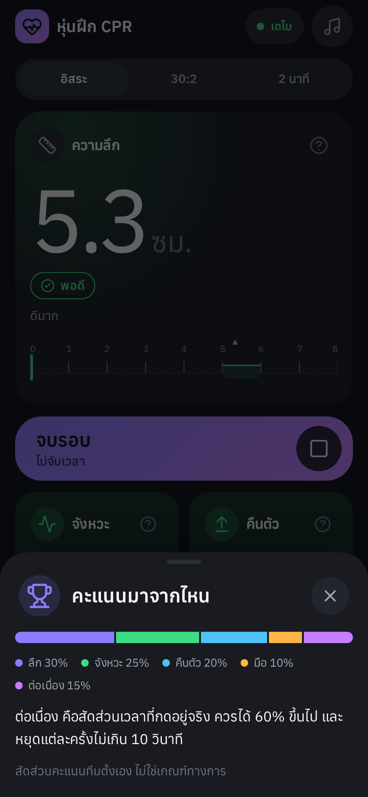
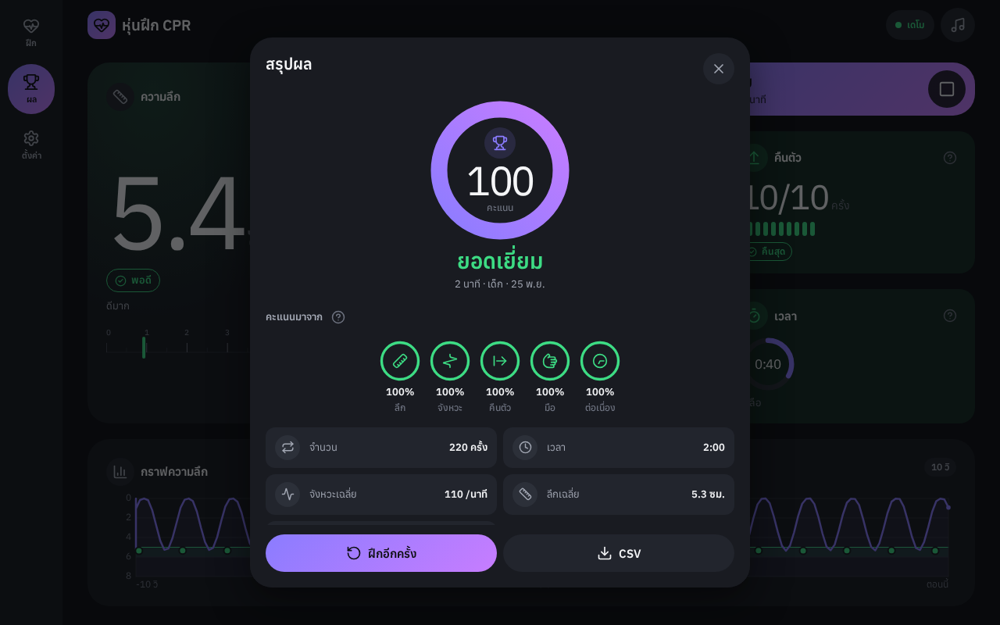
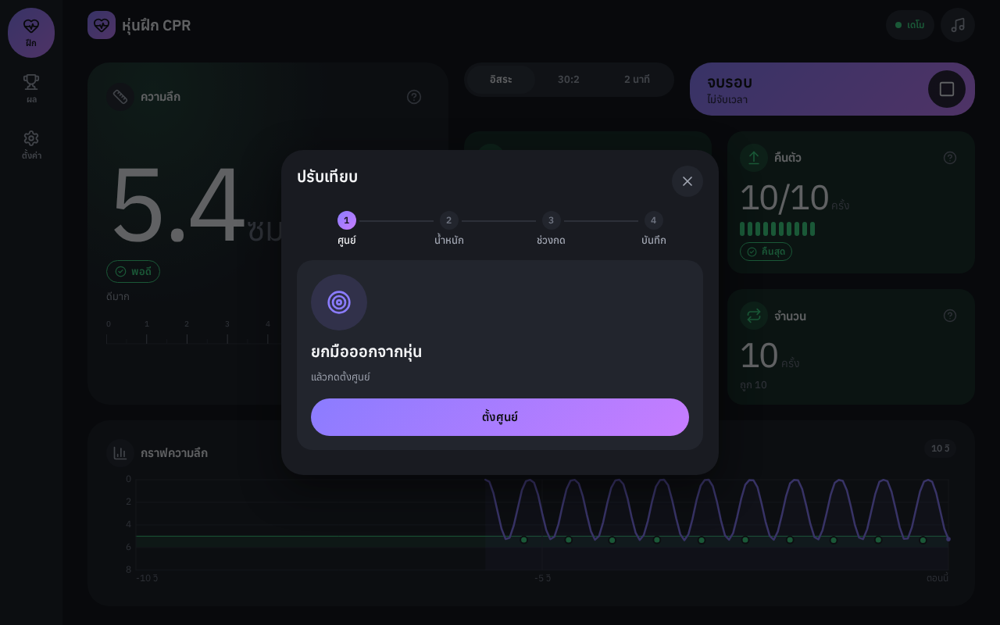
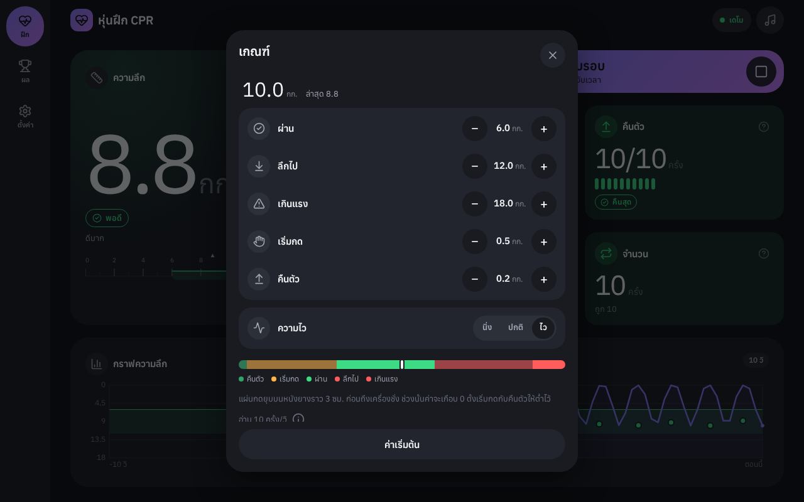
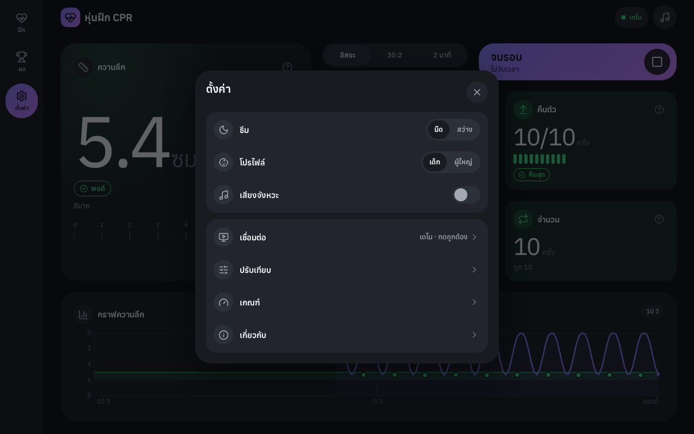
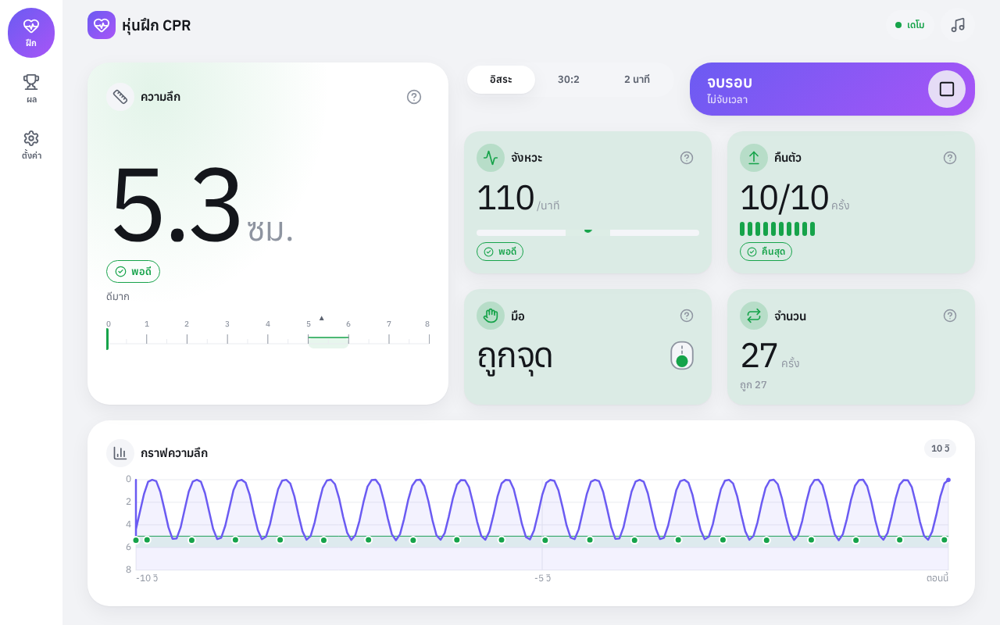

# หน้าแดชบอร์ด

หน้าแดชบอร์ดเป็น HTML, CSS และ JavaScript ธรรมดา ไม่ต้องต่ออินเทอร์เน็ต
เปิดได้จาก Wi-Fi ของ ESP32 หรือจากคอมพิวเตอร์เมื่อใช้ Nano ผ่าน USB
รูปทั้งหมดอยู่ใน `docs/screenshots/`

> สื่อการเรียนรู้ ไม่ใช่เครื่องมือแพทย์

## การเปิดหน้าเว็บและเชื่อมต่อ

หน้าเชื่อมต่อเปิดเองเมื่อยังไม่ได้ต่ออุปกรณ์ เปิดใหม่ได้จากปุ่มสถานะบนแถบด้านบน
หรือแถว **เชื่อมต่อ** ในหน้าตั้งค่า

| วิธี | ใช้กับ | ทำอะไร |
|---|---|---|
| Wi-Fi | ESP32 | ต่อ Wi-Fi `CPR-Trainer-XXXX` รหัส `cprtrain123` แล้วเปิด `http://192.168.4.1` หน้าเว็บจะเชื่อมต่อให้เอง |
| สาย USB | Nano หรือ ESP32 | ใช้ Chrome หรือ Edge บนคอม เลือก **สาย USB** แล้วเลือกพอร์ต |
| เดโม | ไม่ต้องมีหุ่น | เลือกข้อมูลตัวอย่างจากช่อง **เดโม** |

Web Serial ใช้ความเร็ว 115200 ถ้าเบราว์เซอร์ไม่มี `navigator.serial`
การ์ด **สาย USB** จะกดไม่ได้ และขึ้นว่า **เบราว์เซอร์นี้ไม่รองรับ**

ชุดเดโมมี `good`, `shallow`, `cycle`, `test2min` และ `kgonly_good` เล่นซ้ำอัตโนมัติ
ชุด `kgonly_good` ใช้หน่วย กก. และไม่มีสวิตช์มือ เหมือนหุ่นรุ่นสุดท้าย
ปุ่มสถานะบนแถบด้านบนแสดง **เดโม**, **เชื่อมต่อแล้ว**, **กำลังต่อ** หรือ **ไม่ได้ต่อ**



## หน้าฝึก

ขนาดหน้าจอต่างกันแค่การจัดวาง หน้าจอโทรศัพท์เรียงเป็นคอลัมน์เดียว
มีแถบเมนูลอยด้านล่าง ส่วนแนวนอน 844×390 ใช้แถบเมนูด้านข้างและแบ่งเป็นสองคอลัมน์
แท็บเล็ตจำกัดความกว้างเนื้อหาไว้กลางจอ และเดสก์ท็อปใช้แถบเมนูด้านข้าง
โดยให้การ์ดความลึกอยู่ซ้าย การ์ดอื่นอยู่ขวา และกราฟอยู่ล่างสุด

การ์ดความลึกใหญ่สุดในหน้า ตัวเลขใหญ่คือความลึกสูงสุดของการกดครั้งล่าสุด
ไม่ใช่ค่าที่กำลังกดอยู่ จึงเปลี่ยนครั้งละหนึ่งการกด หน่วยเป็น ซม. หรือ กก.
ใต้ตัวเลขมีป้ายสถานะ **ตื้นไป · พอดี · ลึกไป · พร้อม** พร้อมไอคอนและสี
ถัดลงมาเป็นข้อความสั้น **กดลึกอีกนิด · ดีมาก · เบาลงหน่อย · เริ่มกดได้เลย**
ด้านล่างเป็นไม้บรรทัด 0–8 ซม. (โหมด กก. ใช้ช่วงถึงค่ากดเกิน) มีแถบเป้าหมายสีเขียว
ตัวชี้ค่าปัจจุบันที่ขยับตามการกด และเครื่องหมาย ▲ ที่ยอดกดครั้งล่าสุด

การ์ดสี่ใบใช้รูปแบบเดียวกัน คือไอคอนกับชื่อ ค่า และสถานะ

- **จังหวะ** แสดงจำนวนครั้งต่อนาที ป้ายเป็น **ช้าไป · พอดี · เร็วไป**
  พร้อมแถบช่วง 60–160 ที่เน้นช่วง 100–120
- **คืนตัว** แสดงจำนวนครั้งที่คืนตัวสุดจาก 10 ครั้งล่าสุด ป้ายเป็น **คืนสุด** หรือ **ยังค้าง**
  และมีช่องเล็ก 10 ช่องแทน 10 ครั้งล่าสุด
- **มือ** แสดงคำ **ถูกจุด** หรือ **ผิดจุด** พร้อมรูปหน้าอกและจุดวางมือ
  ถ้าบอร์ดรายงานว่าไม่มีสวิตช์มือ การ์ดนี้จะซ่อนไป
- **จำนวน** เปลี่ยนชื่อตามโหมด โหมดอิสระนับครั้งและบอก **ถูก N**
  โหมด 30:2 เป็นวงแหวน `N/30` กับ **รอบที่ N** โหมด 2 นาทีเป็นเวลาถอยหลังกับคำว่า **เหลือ**

การ์ดกราฟชื่อ **กราฟความลึก** แสดง 10 วินาทีล่าสุด มีแถบเป้าหมายสีเขียว
เส้นความลึกสีม่วง และจุดที่ยอดกดแต่ละครั้งสีตามระดับความลึก

เหนือการ์ดขึ้นไปมีแบนเนอร์เตือนสามแบบ

- **ไม่เจอเครื่องชั่ง** ขึ้นเมื่อบอร์ดหา HX711 ไม่พบ ให้ตรวจสาย HX711
  บอร์ดจะลองใหม่เองทุกวินาที
- **เซนเซอร์อ่านช้า** ขึ้นเมื่อ HX711 อ่านได้ต่ำกว่า 8 ครั้ง/วินาที
  ค่า 10 ครั้ง/วินาทีของ HX711 ทั่วไปถือว่าปกติและไม่เตือน
- **กดแรงเกิน** ขึ้นเมื่อค่าที่อ่านได้เกินเกณฑ์ เกินแรง

ESP32 รุ่นสุดท้ายไม่มีสวิตช์มือ การ์ด **มือ** จึงไม่แสดง
แต่การ์ดอื่นและกราฟยังทำงานเหมือนเดิม





## โหมด อิสระ · 30:2 · 2 นาที

สลับโหมดได้ที่ปุ่ม **อิสระ · 30:2 · 2 นาที** ใต้แถบด้านบน

| โหมด | การนับ | จบเมื่อ |
|---|---|---|
| อิสระ | นับทุกครั้งที่กด | กด **จบรอบ** หรือไม่กดต่อ 30 วินาที |
| 30:2 | วงแหวนนับ 0–30 ต่อรอบ | ครบ 30 ครั้งแล้วมีช่วงพักหายใจ หรือกด **จบรอบ** |
| 2 นาที | นับถอยหลัง 2:00 | ครบ 120 วินาทีหลังการกดครั้งแรก |

ในโหมด 30:2 เมื่อครบ 30 ครั้งจะมีแบนเนอร์ **ให้ลม 2 ครั้ง**
แล้วเริ่มรอบถัดไป

ปุ่มใหญ่กลางหน้าเป็น **เริ่มฝึก** ก่อนเริ่มรอบ และเปลี่ยนเป็น **จบรอบ** ระหว่างฝึก
ปุ่มส่งคำสั่ง `start` และ `stop` รอบจริงเริ่มตอนกดครั้งแรก ไม่ใช่ตอนกดปุ่ม

ปุ่มโน้ตบนแถบด้านบนเปิดหรือปิดเสียงจังหวะ 110 ครั้งต่อนาที
สถานะเดียวกันแสดงในหน้าตั้งค่าที่แถว **เสียงจังหวะ**

## ปุ่ม (i) และแผ่นข้อมูล

ปุ่มวงกลม (i) เปิดแผ่นข้อมูลสั้น ๆ ปิดได้ด้วยปุ่ม x การแตะพื้นหลัง หรือ Escape

| หัวข้อ | เปิดจาก | เนื้อหา |
|---|---|---|
| ความลึก | การ์ดความลึก | ช่วงความลึกของเด็กและผู้ใหญ่ อ้างอิง AHA 2025 |
| จังหวะ | การ์ดจังหวะ | 100–120 ครั้งต่อนาที และวิธีเปิดเสียงจังหวะ |
| คืนตัว | การ์ดคืนตัว | ยกมือให้หน้าอกกลับขึ้นสุดทุกครั้ง |
| ตำแหน่งมือ | การ์ดมือ | วางส้นมือบนครึ่งล่างของกระดูกหน้าอก |
| การนับ | การ์ดจำนวน | สิ่งที่นับในแต่ละโหมด |
| คะแนนมาจากไหน | หัวข้อ **คะแนนมาจาก** ในหน้าสรุป | สัดส่วนคะแนนห้าส่วนและเป้าหมายความต่อเนื่อง |
| เซนเซอร์อ่านช้า | แบนเนอร์เซนเซอร์อ่านช้า | สาเหตุที่อ่านต่ำกว่า 8 ครั้งต่อวินาทีและวิธีแก้ |
| เกี่ยวกับ | แถว **เกี่ยวกับ** ในหน้าตั้งค่า | ชื่อโครงงาน ข้อความไม่ใช่เครื่องมือแพทย์ บอร์ด เฟิร์มแวร์ ช่องทางเชื่อมต่อ และบรรทัดระบบ |

เรื่อง "ต่อเนื่อง" อธิบายไว้ในแผ่น "คะแนนมาจากไหน" คือสัดส่วนเวลาที่กดอยู่จริง
เป้าหมายคือ 60% ขึ้นไป และหยุดแต่ละครั้งไม่เกิน 10 วินาที



## สรุปผล

หน้าสรุปเปิดเองเมื่อได้รับผลรอบ ถ้าปิดไปแล้วเปิดใหม่ได้จากเมนู **ผล**
ถ้ายังไม่มีผลจะขึ้น **ยังไม่มีผล**, **กดเริ่มฝึกก่อน** และปุ่ม **ไปฝึก**

ส่วนบนเป็นวงแหวนคะแนน 0–100 พร้อมถ้วยรางวัล ตัวเลข และคำว่า **คะแนน**
ใต้ลงมาเป็นคำระดับ

- **ยอดเยี่ยม** ตั้งแต่ 85
- **ดี** ตั้งแต่ 70
- **พอใช้** ตั้งแต่ 50
- **ฝึกอีกนิด** ต่ำกว่า 50

บรรทัดถัดไปบอกโหมด โปรไฟล์ และวันที่ เช่น `2 นาที · เด็ก · 24 พ.ย.`

ใต้หัวข้อ **คะแนนมาจาก** มีวงแหวนเล็กห้าวง คือ **ลึก · จังหวะ · คืนตัว · มือ · ต่อเนื่อง**
วงแหวนเติมตามเปอร์เซ็นต์จริง สีของสี่วงแรกคือเขียวตั้งแต่ 80, เหลือง 50–79, แดงต่ำกว่า 50
วง **ต่อเนื่อง** ใช้เป้าหมาย 60% จึงเป็นเขียวตั้งแต่ 60, เหลือง 40–59, แดงต่ำกว่า 40

ถัดมาเป็นรายการข้อมูล

- **จำนวน** ครั้งทั้งหมด
- **เวลา** ของรอบ
- **จังหวะเฉลี่ย** ครั้งต่อนาที
- **ลึกเฉลี่ย** ของยอดกด
- **หยุดนานสุด** หรือ **ไม่มี**
- **รอบ 30:2** เฉพาะโหมด 30:2

ส่วนล่างมีปุ่ม **ฝึกอีกครั้ง** เริ่มรอบใหม่ และปุ่ม **CSV** ดาวน์โหลดข้อมูล
พร้อมข้อความ **สื่อการเรียนรู้ ไม่ใช่เครื่องมือแพทย์**

คะแนนคิดจาก

```
0.30 * ความลึกถูก %
+ 0.25 * จังหวะถูก %
+ 0.20 * คืนตัวสุด %
+ 0.10 * มือถูกตำแหน่ง %
+ 0.15 * min(100, CCF % * 100 / 60)
```

สัดส่วนนี้ทีมตั้งเอง ไม่ใช่เกณฑ์ทางการ



### ไฟล์ CSV

ชื่อไฟล์ `cpr-session-YYYYMMDD-HHMM.csv` เป็น UTF-8 มี BOM เพื่อให้ Excel อ่านภาษาไทยได้
แถวแรกเป็นหัวตารางของการกดแต่ละครั้ง

```
index,time_s,peak,unit,depth_level,bpm,rate_level,recoil_ok,hand_ok,all_ok
```

| คอลัมน์ | ค่า |
|---|---|
| `index` | ลำดับการกด เริ่มที่ 1 |
| `time_s` | เวลาวินาทีจากครั้งแรก |
| `peak` | ค่ายอดกด 1 ตำแหน่ง |
| `unit` | `mm` หรือ `kg` |
| `depth_level` | `none`, `shallow`, `good`, `deep` |
| `bpm` | อัตราตอนยอดกด |
| `rate_level` | `none`, `slow`, `good`, `fast` |
| `recoil_ok` | 1 = คืนตัวสุด, 0 = ไม่ |
| `hand_ok` | 1 = มือถูกตำแหน่ง, 0 = ไม่ |
| `all_ok` | 1 = ผ่านทั้งสี่อย่าง |

หลังข้อมูลการกดมีบรรทัดว่าง แล้วตามด้วยบรรทัดสรุป `summary_field,value`
เช่น `score`, `mode`, `profile`, `count`, `depth_good`, `rate_good`, `recoil_good`,
`hand_good`, `all_good`, `duration_s`, `longest_pause_ms`, `mean_peak`, `mean_bpm`,
`cycles` และ `ccf`

## ปรับเทียบ

เปิดจากแถว **ปรับเทียบ** ในหน้าตั้งค่า ตัวช่วยมี 4 ขั้น
ชื่อขั้นคือ **ศูนย์ · น้ำหนัก · ช่วงกด · บันทึก**

1. **ยกมือออกจากหุ่น** แล้วกด **ตั้งศูนย์**
2. **วางของที่รู้น้ำหนัก** กรอกน้ำหนักเป็นกิโลกรัม แล้วกด **บันทึก**
3. **ช่วงกด** ถ้ามี ToF ให้กดช้า ๆ หลายครั้งแล้วกด **เสร็จ**
   ถ้าไม่มี ToF ให้กดให้ลึก 5 ซม. และ 6 ซม. แล้วกด **เก็บค่า** ทีละจุด
4. **บันทึกลงหุ่น** กด **บันทึก** รอจนขึ้น **เสร็จแล้ว**

ขั้นตอนและคำสั่งเต็มอยู่ใน [`calibration.md`](calibration.md)



## เกณฑ์

เปิดจากแถว **เกณฑ์** ในหน้าตั้งค่า ใช้ปรับเส้นแบ่งน้ำหนักโดยไม่ต้องแก้โค้ด
แถวนี้จะซ่อนเมื่อเชื่อมต่อกับ Nano

ด้านบนของแผ่นมีค่า กก. ปัจจุบัน และค่า **ล่าสุด X.X**
ซึ่งคือยอดกดครั้งล่าสุด ใช้ค่านี้ช่วยตั้งเกณฑ์

| แถว | ความหมาย |
|---|---|
| ผ่าน | เริ่มนับว่าลึกพอดี |
| ลึกไป | เริ่มนับว่าลึกเกินไป |
| เกินแรง | เริ่มเตือนว่ากดแรงเกิน |
| เริ่มกด | ค่าที่ถือว่าเริ่มกดหนึ่งครั้ง |
| คืนตัว | ค่าที่ถือว่าแผ่นกดยกออกจากโหลดเซลล์แล้ว |
| ความไว | **นิ่ง** (0.4), **ปกติ** (0.7) หรือ **ไว** (1.0) |

แถบสีใต้รายการแสดงช่วง คืนตัว · เริ่มกด · ผ่าน · ลึกไป · เกินแรง
พร้อมตัวชี้ค่าที่อ่านได้ตอนนี้

เมื่อแก้ค่า หน้าเว็บจะส่ง `set th` ให้เองหลังหยุดกดปุ่มประมาณ 0.4 วินาที
ปุ่ม **ค่าเริ่มต้น** ส่ง `set reset`
ค่าที่ตั้งจะถูกเก็บลงหน่วยความจำของหุ่นทันที

การตั้งเกณฑ์สำหรับหุ่นที่มีหนังยางหน่วงอยู่ใน
[`calibration.md`](calibration.md)



## ตั้งค่า

เปิดจากเมนู **ตั้งค่า**

- **ธีม** เลือก **มืด** หรือ **สว่าง** ค่าถูกจำไว้ในเบราว์เซอร์เครื่องนั้น
- **โปรไฟล์** เลือก **เด็ก** หรือ **ผู้ใหญ่** ค่าเริ่มต้นคือ **เด็ก**
- **เสียงจังหวะ** เปิดหรือปิดเสียง 110 ครั้งต่อนาทีบนตัวหุ่น
- **เชื่อมต่อ** แสดงสถานะปัจจุบัน เปิดหน้าเชื่อมต่อ
- **ปรับเทียบ** เปิดตัวช่วย 4 ขั้น
- **เกณฑ์** เปิดแผ่นปรับเส้นแบ่งน้ำหนัก (ซ่อนบน Nano)
- **เกี่ยวกับ** เปิดข้อมูลบอร์ด เฟิร์มแวร์ และข้อความไม่ใช่เครื่องมือแพทย์

บรรทัดล่างสุดของ **เกี่ยวกับ** เป็นบรรทัดระบบที่หุ่นส่งมาทุก 5 วินาที
หน้าตาเช่น `ระบบ · เปิดมา 5 นาที · อ่าน 10/วิ · สาย USB ปิด · ข้อมูลเสีย 0 · หลุด 0`
ใช้ดูว่าระบบยังทำงานอยู่ และ Wi-Fi รับข้อมูลทันหรือเปล่า
ความหมายของแต่ละค่า และวิธีทดสอบด้วยสายชาร์จ อยู่ใน
[`troubleshooting.md`](troubleshooting.md)





## แอนิเมชัน

แอนิเมชันใช้ CSS transition และ keyframe กับ JavaScript เล็กน้อย ไม่มีไลบรารี
สิ่งที่ขยับคือแถบโหมดที่เลื่อนตามโหมดที่เลือก ไอคอนเมนูที่เลื่อนตามหน้าที่เปิด
ตัวชี้ความลึกและจุดจังหวะที่ตามค่าจริงแบบหน่วง ตัวเลขความลึกที่พลิกเมื่อจบการกดหนึ่งครั้ง
วงแหวนสรุปที่ค่อย ๆ เต็ม และแผ่นข้อมูลที่เลื่อนขึ้นหรือจางเข้า

ค่าที่อ่านจากหุ่นไม่รอแอนิเมชัน ค่าใหม่ทับค่าเก่าได้ทันที
ถ้าระบบขอ reduced motion หรือเปิดด้วย `motion=freeze` ทุกอย่างจะเป็นค่าสุดท้ายทันที

## พารามิเตอร์ URL

ใช้ตอนพัฒนาและตอนถ่ายภาพหน้าจอ

| พารามิเตอร์ | ค่า | ผล |
|---|---|---|
| `demo` | `good`, `shallow`, `cycle`, `test2min`, `kgonly_good` | เปิดเดโมด้วยชุดข้อมูลที่เลือก |
| `speed` | 0.1–20 | เร่งความเร็วเดโม |
| `seek` | วินาที | กระโดดไปตำแหน่งนั้นของชุดข้อมูล |
| `theme` | `dark`, `light` | กำหนดธีม |
| `sheet` | `summary`, `calib`, `th`, `settings`, `connect`, `info` | เปิดแผ่นข้อมูลที่เลือก |
| `info` | `depth`, `rate`, `recoil`, `hand`, `count`, `ccf`, `score`, `sps`, `about` | เลือกหัวข้อเมื่อ `sheet=info` |
| `mock` | `nohx`, `nohand`, `diag` (คั่นด้วย comma) | จำลองสถานะในเดโม: `nohx` ขึ้นแบนเนอร์ไม่เจอเครื่องชั่ง, `nohand` ซ่อนการ์ดมือ, `diag` ส่งบรรทัดระบบทุก 5 วินาที |
| `ws` | `1` | รับข้อมูลจาก dev server ผ่าน WebSocket |
| `motion` | `freeze` | ปิดแอนิเมชันและแสดงค่าสุดท้าย |

ตัวอย่าง `?demo=good&seek=14&sheet=info&info=score&motion=freeze`
เปิดเดโม กระโดดไปวินาทีที่ 14 แล้วเปิดแผ่นคะแนนโดยไม่เล่นแอนิเมชัน

## ไอคอนและฟอนต์

ไอคอนใช้ Lucide ภายใต้สัญญา ISC ฝังเป็น SVG sprite ไว้ใน `web/index.html`
ฟอนต์ Anuphan ภายใต้สัญญา OFL ฝังมากับโปรเจกต์เป็นไฟล์ `woff2` และถูกฝังไปกับเฟิร์มแวร์
ทั้งสองไม่โหลดจาก CDN ข้อความสัญญาอยู่ใน [`web/LICENSES.txt`](../web/LICENSES.txt)

## ขนาดไฟล์

วัดด้วย gzip ระดับ 9 แบบ mtime 0 ซึ่งเป็นแบบที่ `tools/embed_web.py` ใช้ฝังลงเฟิร์มแวร์

| ไฟล์ | ขนาด gzip |
|---|---:|
| `web/index.html` | 8,191 ไบต์ |
| `web/app.css` | 9,953 ไบต์ |
| `web/app.js` | 24,744 ไบต์ |
| `web/fonts/anuphan-thai.woff2` | 35,409 ไบต์ |
| ไฟล์อื่น (`LICENSES.txt`, `OFL.txt`) | 3,562 ไบต์ |
| รวมทั้งเว็บ (ไม่รวม `demo/*.jsonl`) | 81,859 ไบต์ (79.9 KiB) |

เฟิร์มแวร์ ESP32 ใช้แฟลช 84.3% (1,104,927 จาก 1,310,720 ไบต์)
ไฟล์ `demo/*.jsonl` ฝังแยกต่างหากและไม่ได้นับในตารางนี้
